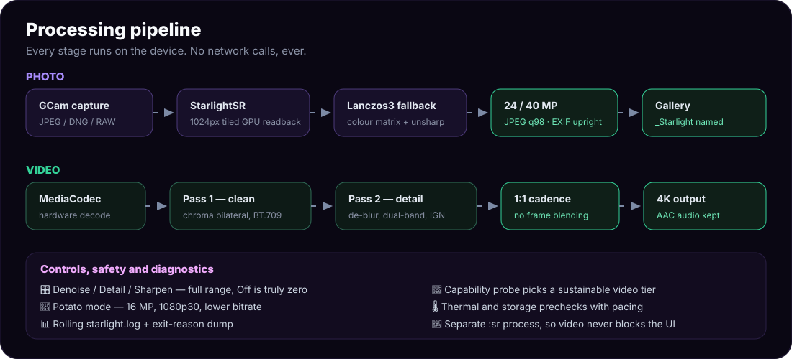
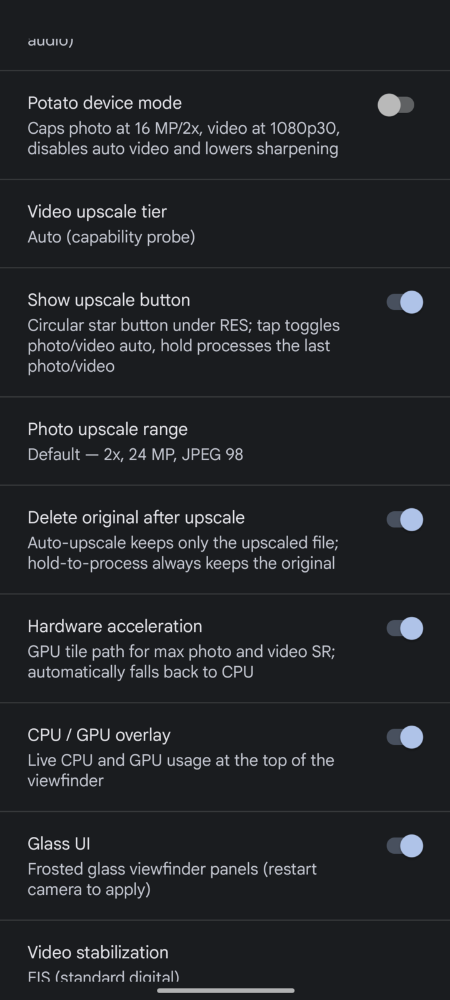
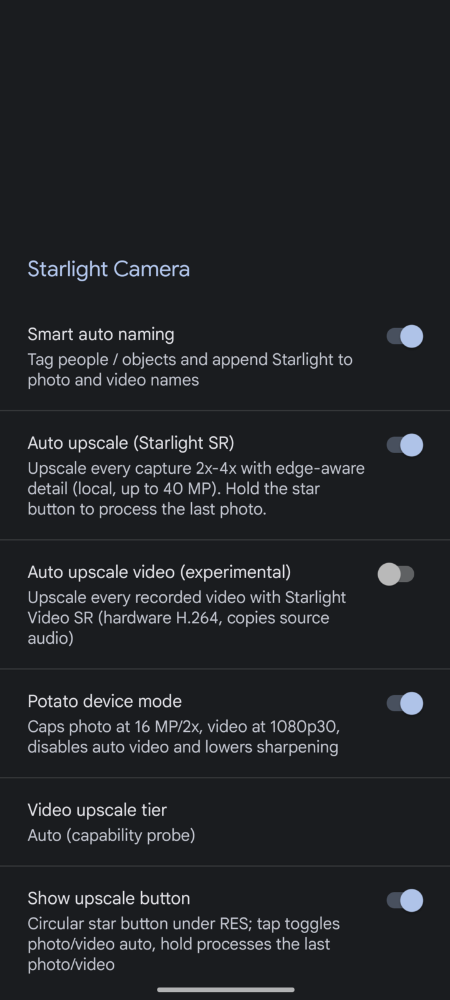
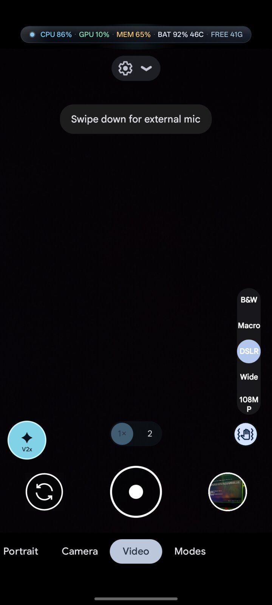

<div align="center">


# 📷 Starlight Camera vMax

**Your phone's camera, unlocked.** A glass-UI GCam port with on-device photo
and video super-resolution, built and tuned for the **Redmi Note 10 Pro Max**.

**No cloud. No account. No subscription.** Every enhancement runs on your own
device — your photos never leave it.

[](https://github.com/Starlightmii/starlight-camera/releases/latest)
[](https://github.com/Starlightmii/starlight-camera/releases/latest)
[](https://github.com/Starlightmii/starlight-camera/releases/latest)
[](https://github.com/Starlightmii/starlight-camera/releases/latest)
[](https://github.com/Starlightmii/starlight-camera/releases/latest)

### [⬇️ Download the APK](https://github.com/Starlightmii/starlight-camera/releases/latest) · [▶️ Watch the demo](#-demo) · [📸 Screenshots](#-screenshots) · [✨ Features](#-features) · [🚀 Install](#-install) · [📖 How to use](#-how-to-use) · [❓ FAQ](#-faq)

</div>

---


## 🤔 What this actually does

A stock GCam port is already good. What it will not do is make a photo **bigger**
or a video **sharper** after the fact — and it certainly will not do either of
those on the phone itself.

Starlight Camera adds exactly that, plus a UI that does not look like a 2018
leaked build:

| The problem | What Starlight does |
|---|---|
| Your 12 MP photos are soft when you crop or print | Upscales to **24 MP by default, 40 MP max** on-device, with colour and edge-aware sharpening. |
| Your 1080p video looks mushy on a big screen | Rebuilds it to **4K** with a two-pass GPU pipeline and keeps the audio. |
| Every photo is called `IMG_20261113_...` | Names files by **what is in them** — `Night_`, `Portrait_`, `Macro_`, `Video_` … `_Starlight`. |
| Enhancement apps want a subscription and your photos | **Nothing is uploaded.** All processing is local, offline, free. |
| Low-end phones choke on camera mods | **Potato mode**: 16 MP, 1080p30, lower bitrate — still sharp, much faster. |
| Modded cameras look sketchy | ColorOS-style **liquid-glass UI**, live CPU/GPU/RAM/battery readout, animated processing bar. |

---



---

## ✨ All features

### 🖼️ Photo

- ⬆️ **On-device super-resolution** — 24 MP default, **40 MP maximum**, 2× scale.
- 🧵 **Tiled GPU readback** — 1024 px tiles with a fixed FBO, so huge images do
  not blow up memory. Lanczos3 and RenderScript stay as fallbacks.
- 🎨 **Tensei colour matrix** — the real pipeline: saturation 1.15, contrast
  1.15, cross-kernel sharpen, edge-gated so flat areas stay clean.
- 🧭 **DNG orientation fixed in `.51`** — portrait DNGs now come out upright.
  TIFF IFD0 orientation is read directly when `ExifInterface` returns 0.
- 🧠 **Smart auto-naming** — `Person_`, `Selfie_`, `Laptop_`, `Macro_`, `Wide_`,
  `Night_`, `108MP_`, `B&W_`, `Document_`, `Video_`, `Timelapse_` … `_Starlight`.
- 🗑️ **Optional original cleanup** — keep only the upscaled file, or keep both.
- 🖱️ **One-tap upscale** — a button in the UI, plus **hold-to-process** on the
  thumbnail.
- 🥔 **Potato photo path** — 16 MP output for slower devices.
- 🖼️ **Media opener** — tapping the preview thumbnail opens the upscaled shot in
  your own gallery (ColorOS Gallery or Google Photos).

### 🎬 Video

- 🎞️ **4K video super-resolution** — 1080p in, **3840×2160** out, hardware
  MediaCodec decode and encode.
- 🌀 **Two-pass GPU pipeline** (the "Gemini" path):
  - **Pass 1 — clean:** chroma bilateral + motion-gated temporal accumulation,
    BT.709 luma packed in alpha.
  - **Pass 2 — detail:** directional edge de-blur, dual-band frequency
    separation, luma-only gain, S-curve, IGN dithering.
- 🎯 **1:1 frame cadence** — one encoded frame per source frame. No interpolation,
  so no ghosting on moving subjects.
- 🌈 **BT.709 / full-range / SDR forced** on encoder and muxer. No more green
  tint from mismatched colour metadata.
- 🔊 **Audio preserved** — AAC passthrough, in sync.
- 🧠 **Capability probe** — picks the video tier your phone can actually sustain
  (1080p / 1440p / 4K) instead of crashing on 4K.
- 🌡️ **Thermal and storage prechecks** with pacing, so long clips do not cook
  the phone or fill the disk.
- 🧵 **Separate `:sr` process** — video work runs out of the camera's way.
- 🎥 **1080p60, time-lapse and slow motion** supported.
- 🔔 **Foreground service + live progress** — a notification and an animated
  rainbow bar, not a mystery freeze.

### 🎛️ Controls

- 🎚️ **Denoise / Detail / Sharpen sliders** with a genuinely full range —
  *Off* is truly zero, not "a little bit".
- 🪟 **Glass UI** — ColorOS-style liquid glass, adjustable intensity.
- 📊 **Live telemetry capsule** — CPU, GPU, memory and battery, on screen.
- 🧊 **Dock mode** — a compact floating panel for one-handed shooting.
- 🏷️ **No LMC or Hasli branding** anywhere in the UI, splash, settings or paths.

### 🛠️ Under the hood

- 📊 **Diagnostics** — rolling `starlight/starlight.log` plus an exit-reason dump,
  so a crash is explainable instead of mysterious.
- ⚙️ **Master config included** — a tuned XML (JPEG q98, lens-5 opmodes, reduced
  HDR/ZSL frame counts, media opener on).
- 🔭 **Canon EOS R10 DSLR library included** — the Starlight-branded `.so`, plus
  the original as a fallback.
- 🧩 **Sources published** — Java sources, smali and v2 → vMax diffs are all in
  this repo, not hidden.

---

## ▶️ Demo

<sub>Real 4K output from the device. Click to play — 3 seconds, 11 MB.</sub>

**Video (GitHub attachment player):**

https://github.com/user-attachments/assets/a52dee76-5ab4-46d5-945c-9c254ca5839a

<sub>The player above is GitHub's native video player. The MP4 is also committed
in [`screenshots and video/`](screenshots%20and%20video) if you would rather
download it and watch it locally.</sub>

---

## 📸 Screenshots

<div align="center">


<sub>Main shooting screen — the UI you actually use</sub>





<sub>Settings (default) · settings (potato mode) · video mode chip</sub>

</div>

### 📷 Sample output

| | Resolution | Notes |
|---|---|---|
| Photo, default | **4242 × 5656** | 24 MP, colour matrix + edge-gated sharpen |
| Photo, max mode | up to **7302 × 5476** | 40 MP, longer processing, best for prints |
| Photo, potato mode | **3464 × 4618** | 16 MP, fast path for slower phones |
| Video | 1920×1080 → **3840×2160** | HEVC or H.264, AAC audio kept, BT.709 |

<sub>Sample frames that contained personal content have been removed from this
repo. The resolution figures above are from the device test logs in
[`reports/STATE.md`](reports/STATE.md).</sub>

---|---|---|
| Source frame | 3000 × 4000 | Straight out of the camera |
| **Upscaled** | **4242 × 5656** | 24 MP, colour matrix + edge-gated sharpen |
| Max mode | up to 7302 × 5476 | 40 MP, longer processing, best for prints |
| Video | 1920×1080 → **3840×2160** | HEVC or H.264, AAC audio kept, BT.709 |

---

## 🚀 Install

### 1. Download

Grab **`Starlight-Camera-vMax.51.apk`** from the
[latest release](https://github.com/Starlightmii/starlight-camera/releases/latest).
Allow installs from your browser or file manager when Android asks.

### 2. Install

```bash
# Remove any previous build first if it came from a different source.
adb uninstall com.google.android.GoogleCameraLMCR17

# Install.
adb install Starlight-Camera-vMax.51.apk
```

Or just tap the APK in your file manager — no root, no ADB needed.

### 3. Import the config *(recommended)*

```bash
adb push Starlight_Master.xml /sdcard/StarlightCamera/Starlight_Master.xml
```

Then in the app: **double-tap the black area near the shutter** → **IMPORT** →
pick `Starlight_Master.xml`. The app restarts with the tuned settings.

### 4. Add the DSLR library *(optional)*

```bash
adb push Starlight_EOS_R10_DSLR.so /sdcard/StarlightCamera/libs/
```

Then **Settings → Libs** and select it.

### 5. Verify your download

```bash
sha256sum Starlight-Camera-vMax.51.apk
# cda6344ae47b87fa76c3629e1b7046cba547d1ec84911b79ae94a78c8a2176e8
```

Full list in [`CHECKSUMS.sha256`](https://github.com/Starlightmii/starlight-camera/releases/latest).

---

## 📖 How to use

### Take an upscaled photo

1. Open the camera and pick a mode (Photo, Night, Portrait, Macro…).
2. Shoot as normal. The enhancement runs automatically when the shot is saved.
3. Watch the **rainbow bar** — that is the upscale running.
4. Your photo lands in the gallery as `Upscaled_<Scene>_<timestamp>.jpg`.

**Max quality:** turn photo quality to **Max** in settings. Expect 40 MP and a
longer wait (roughly 20–30 s on this hardware) — worth it for prints, overkill
for chat.

**Manual upscale:** tap the **upscale button** in the UI, or **hold** the preview
thumbnail to process a photo you already took.

### Shoot an upscaled video

1. Switch to **Video** mode and pick a resolution.
2. Enable **video upscale** in settings (`Video upscale` — off by default,
   because it takes time).
3. Record. When you stop, processing starts: pass 1 cleans, pass 2 rebuilds
   detail, audio is copied through untouched.
4. The result is a separate file — your original is left alone.

**Expectation setting:** a 30-second 1080p clip takes a while at 4K on a
Snapdragon 732G. This is a per-frame GPU job, not a filter. Use **Potato mode**
or a lower tier if you want it fast.

### Tune the three sliders

| Slider | What it does | Try |
|---|---|---|
| **Denoise** | Temporal + chroma cleanup. Higher = cleaner, softer. | Low for daylight, higher for night |
| **Detail** | Dual-band frequency separation and micro-contrast. | Medium is a good default |
| **Sharpen** | Directional edge de-blur. | Low for portraits, higher for text |

*Off* on all three is a genuine bypass — useful for judging how much the
pipeline is actually doing.

### Potato mode

One switch. 16 MP photos, 1080p30 video, lower bitrate, lighter sharpening.
Turn it on when the phone is hot, the battery is low, or you just want the shot
fast.

### Find your photos

```
/sdcard/DCIM/Camera/…_Starlight.jpg          your shots
/sdcard/DCIM/Camera/Upscaled_….jpg           enhanced photos
/sdcard/StarlightCamera/starlight.log         diagnostics
```

### If something goes wrong

1. Grab the log: `/sdcard/StarlightCamera/starlight.log`.
2. Open an [issue](https://github.com/Starlightmii/starlight-camera/issues) and
   paste the last ~50 lines plus what you were doing.
3. The exit-reason dump tells us if Android killed the process (usually memory or
   thermal), which points at the fix.

---

## 🧪 Verified on device

Honest status, not marketing:

- **Device:** Redmi Note 10 Pro Max (`sweetin` / `sweet`), Snapdragon 732G,
  Adreno 618, ColorOS 17 port, Android 13.
- **`.51` installed**, versionCode `64764924`.
- **DNG orientation fix confirmed:** an orientation-6 portrait DNG came back
  2968 × 3968, `Orientation=1`, visually upright. 26 s on device.
- **Photo:** 24 MP in ~8.7 s; 40 MP max in ~11–19 s; macro 40 MP ~11 s.
- **Video:** 1080p → 4K, 30 fps, HEVC + AAC, BT.709 full range, 1:1 cadence,
  audio in sync.
- **Cold launch:** ~1.9 s after moving the exit-info dump off the UI thread.

**Still open:** the JPEG-only path regression, and a long thermal soak test.
Both are tracked in [`reports/STATE.md`](reports/STATE.md).

---

## 📁 What's in this repo

```
src/                     Java sources for every Starlight class
smali/                   Patched smali for the .51 orientation fix
patches/                 v2 → vMax diffs (see exactly what changed)
config/                  Starlight_Master.xml — the tuned master config
release/                 Source bundle + checksums + release notes
screenshots/             Device screenshots
screenshots and video/   Full-resolution samples and the demo video
reports/                 STATE, REPORT, UPSCALE_ANALYSIS, PROBLEM_STATEMENT
fix/                     Starlight Ports registration manifest
assets/                  README artwork (SVG and resized stills)
```

The APK itself is **not** committed to Git — it is a release asset, so clones stay
small and fast.

---

## 🙏 Credits

Starlight Camera is a modification, not a from-scratch camera. All credit to the
people who built the base:

- [**Google Camera (GCam)**](https://en.wikipedia.org/wiki/Google_Camera) — the
  camera application and computational photography pipeline this is built on.
  Proprietary, and its terms continue to apply.
- [**LMC 8.4 R17**](https://github.com/libremultimedia/LMC) — the community port
  that made GCam run on non-Pixel devices. Hasli and the LMC community's work is
  the foundation here.
- **Tensei** — the colour and sharpen pipeline reverse-engineered in
  [`reports/UPSCALE_ANALYSIS.md`](reports/UPSCALE_ANALYSIS.md).
- **Gemini** — the two-pass video GL design.
- **DeepSeek** and **Claude** — design review in `suggestions/`.

What is original here: the Starlight branding, the tiled photo upscaler, the
video super-resolution pipeline, the DNG orientation fix, the potato mode,
the glass UI, smart naming, the capability probe, thermal pacing, and the
diagnostics.

---

## ⚠️ Before you install

- 🔧 **Unofficial, modified APK.** Install only on a device you own and are
  willing to test on.
- 💾 **Back up your current camera app** and any photos you care about.
- 📱 **Built and tested for `sweetin` / `sweet` only**, arm64-v8a. Other devices
  may install but will likely misbehave — the camera HAL and calibration differ.
- 🎯 **Package name is unchanged** (`com.google.android.GoogleCameraLMCR17`), so
  it replaces an existing LMC install rather than sitting beside it.
- ⏱️ **Processing takes real time.** 40 MP photos and 4K video are heavy jobs on
  mid-range hardware. That is the cost of doing it on-device.
- 🧾 **No warranty.** Provided as-is, with sources published so you can read
  exactly what it does.
- 🔌 **No network access.** The enhancement paths never upload your media.

---

## 💬 Questions

**Does this root my phone?**
No. Plain APK install, no root, no Magisk.

**Will it work on my Redmi Note 10 Pro (non-Max)?**
Untested. Same family, different sensor and calibration — the config is tuned for
Max, so expect to need your own XML.

**Why is the APK 132 MB?**
GCam ships a full HDR+ network and per-device calibration. That is the base app,
not bloat we added.

**Does video enhancement keep the audio?**
Yes — AAC passthrough, sample-accurate.

**Is there an iOS version?**
No. This is Android-only and device-specific.

**Something is broken — where do I start?**
[`reports/PROBLEM_STATEMENT.md`](reports/PROBLEM_STATEMENT.md) documents the
known hard parts, and [`reports/STATE.md`](reports/STATE.md) has the live status.
Then open an issue with your log.

---

<div align="center">


**If this made your photos better, ⭐ the repo** — it is the only thanks needed.

[⬇️ Download](https://github.com/Starlightmii/starlight-camera/releases/latest) ·
[🐞 Report a bug](https://github.com/Starlightmii/starlight-camera/issues) ·
[📊 Starlight Ports](https://github.com/Starlightmii/starlight-ports)

<sub>Built on Google Camera and LMC 8.4 · Starlight modifications · not affiliated
with Google or the LMC project · no media is ever uploaded</sub>

</div>
