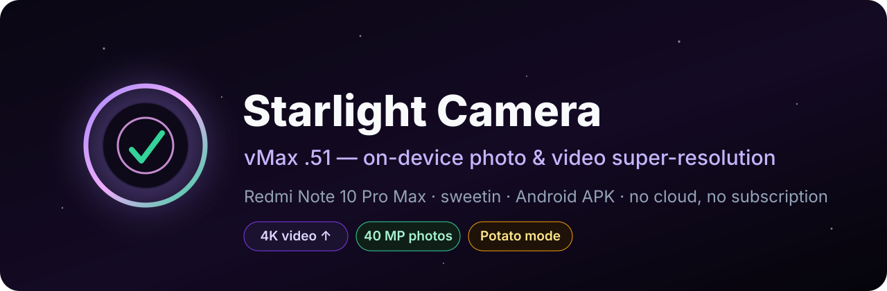
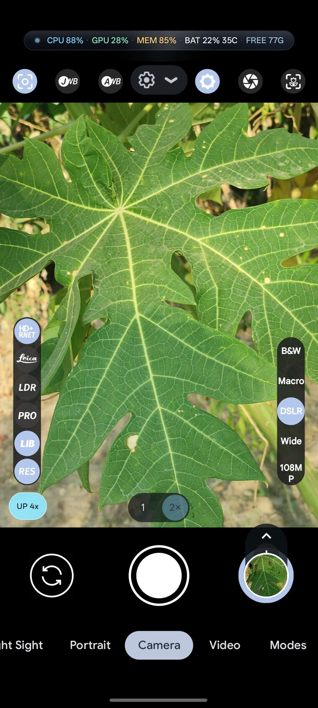
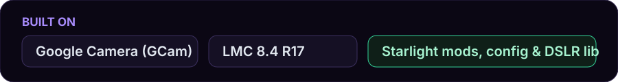

<div align="center">





# 📷 Starlight Camera

**Your phone's camera, unlocked.** A glass-UI GCam port with on-device photo and
video super-resolution, built for the **Redmi Note 10 Pro Max**.

No cloud. No account. No subscription. Your photos never leave your phone.

[](https://github.com/Starlightmii/starlight-camera/releases/latest)
[](https://github.com/Starlightmii/starlight-camera/releases/latest)
[](#-what-it-does)

[▶️ Demo](#-demo) · [📸 Screenshots](#-screenshots) · [⬇️ Install](#-install) · [📖 How to use](#-how-to-use) · [❓ Help](#-if-something-breaks)

</div>

---

## ✨ What it does


---

## 📸 Screenshots

<div align="center">




<sub>The camera · settings · potato mode · video mode</sub>

</div>

---

## ▶️ Demo

<sub>Real 4K output from the device. **No audio track at all** — the file was
stripped with `ffmpeg -an`, so nothing can play sound from it.</sub>

https://github.com/user-attachments/assets/fd2f6c26-102b-444d-87c9-b53441eb8a99

---

## ⬇️ Install



<sub>That is the whole install. No PC, no cable, no root — all on the phone.</sub>

**Short version**

1. **Download** `Starlight-Camera-vMax.51.apk` from [Releases](https://github.com/Starlightmii/starlight-camera/releases/latest).
2. **Uninstall** any old GCam / LMC build first — the package name is the same.
3. **Tap the APK** in your file manager and install.
4. **Open it** and allow Camera, Photos and Microphone.



---

<details>
<summary><b>Optional: load the tuned config and the library</b></summary>

<br>

**Config** — copy `Starlight_Master.xml` into `/sdcard/LMC8.4/`, then in the app
double-tap the black area beside the shutter → **IMPORT** → pick the file. The app
restarts already tuned.

**Library** — copy `Starlight_EOS_R10_DSLR.so` into `/sdcard/LMC8.4/libs/`.



<sub>Settings → Photo processing → Library → choose the file in the **Main**,
**Tele**, **Wide** and **Front** rows, then restart the camera.</sub>

</details>

---

## 📖 How to use



**Upscaled photo** — shoot as normal. The rainbow bar means the upscale is
running. You get `Upscaled_<Scene>_<date>.jpg` next to the original.

**Upscaled video** — turn **Video upscale** on, record, then hold the upscale
chip. The 4K copy lands beside the original; the audio is kept in sync.

**Slow phone?** Turn on **Potato mode**. 16 MP photos, 1080p video, much faster.

**Where files land**

```
/sdcard/DCIM/Camera/                  your shots, named by what is in them
/sdcard/LMC8.4/Starlight_Master.xml   the config
/sdcard/LMC8.4/libs/                  the library
```

---

## ❓ If something breaks

| Problem | Fix |
|---|---|
| Will not install | Uninstall the old LMC / GCam build first |
| Config does not load | XML must sit in `/sdcard/LMC8.4/`, then double-tap → IMPORT |
| Upscale does nothing | Turn **Auto upscale** on in Settings |
| Video upscale fails | Keep 1.5× the output size free; avoid 10-bit HDR sources |
| Preview tap is dead | Pick a media opener app in Settings |
| Crashes on launch | Settings → Apps → Clear Data, then reopen |

Still stuck? Grab `/sdcard/Android/data/com.google.android.GoogleCameraLMCR17/files/starlight/starlight.log`
and open an [issue](https://github.com/Starlightmii/starlight-camera/issues).

---

<details>
<summary><b>🔧 Built on, verified status, and the boring but important bits</b></summary>

<br>



**Built on** [Google Camera (GCam)](https://en.wikipedia.org/wiki/Google_Camera)
and [LMC 8.4 R17](https://github.com/libremultimedia/LMC), with Starlight
modifications: the tiled upscaler, the two-pass video pipeline, the DNG
orientation fix, potato mode, the glass UI, smart naming, the capability probe,
thermal pacing and the diagnostics.

**Verified on device** — Redmi Note 10 Pro Max (`sweetin`), Snapdragon 732G,
ColorOS 17, Android 13, arm64-v8a. `.51` installed, versionCode `64764924`.
Portrait DNG returns 2968×3968 upright. 24 MP in ~8.7 s, 40 MP in ~11–19 s.
Video 1080p → 4K, 30 fps, HEVC + AAC, BT.709. Cold launch ~1.9 s.
Still open: JPEG-only path regression, long thermal soak.

**Package** `com.google.android.GoogleCameraLMCR17` · **Version**
`8.4.300.414775575.51-vMax` · **Build** 13 Nov 2026
· **SHA-256** `cda6344a…2176e8`

**Please read** — unofficial modified APK. Install only on a device you own.
Back up first. Tested on `sweetin` only; other devices will likely misbehave.
Processing 40 MP photos and 4K video takes real time on mid-range hardware —
that is the cost of doing it on-device. No warranty.

[`src/`](src) [`smali/`](smali) [`patches/`](patches) [`config/`](config)
[`reports/`](reports) — all published, nothing hidden.

</details>

---

<div align="center">

**If this made your photos better, ⭐ the repo** — that is the only thanks needed.

[⬇️ Download](https://github.com/Starlightmii/starlight-camera/releases/latest) ·
[🐞 Report a bug](https://github.com/Starlightmii/starlight-camera/issues) ·
[📊 Starlight Ports](https://github.com/Starlightmii/starlight-ports)

<sub>Not affiliated with Google or the LMC project · no media is ever uploaded</sub>

</div>