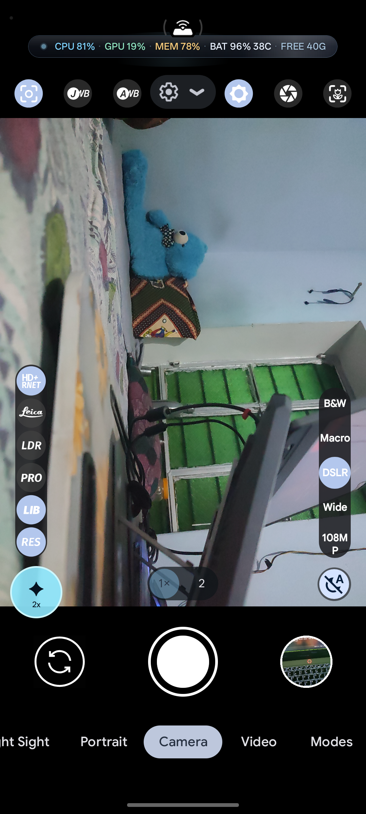
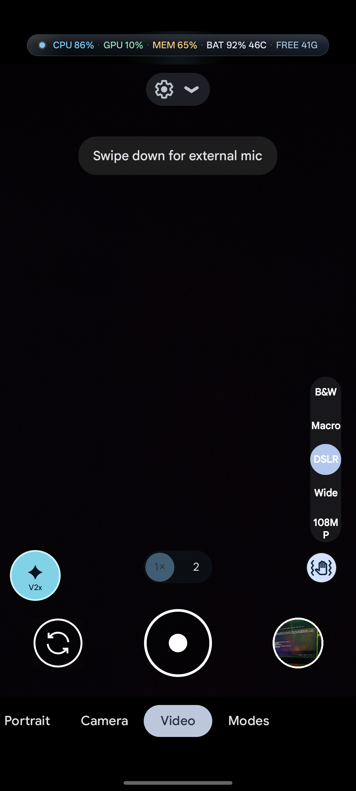
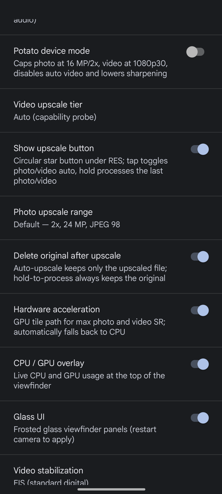

## 📷 Starlight Camera vMax .51

A heavily modified LMC 8.4 GCam port for the Redmi Note 10 Pro Max, with on-device photo and video super-resolution and a Starlight glass UI.

### ⬇️ Downloads
| File | What it is |
|---|---|
| [Starlight-Camera-vMax.51.apk](https://github.com/Starlightmii/starlight-camera/releases/download/vmax-51/Starlight-Camera-vMax.51.apk) | The camera app — **install this** |
| [Starlight_EOS_R10_DSLR.so](https://github.com/Starlightmii/starlight-camera/releases/download/vmax-51/Starlight_EOS_R10_DSLR.so) | Starlight-branded Canon EOS R10 DSLR library |
| [Starlight_Master.xml](https://github.com/Starlightmii/starlight-camera/releases/download/vmax-51/Starlight_Master.xml) | Master config (import in LMC Configs) |
| [Starlight-Camera-vMax-source.zip](https://github.com/Starlightmii/starlight-camera/releases/download/vmax-51/Starlight-Camera-vMax-source.zip) | Java sources, smali and patches |
| [CHECKSUMS.sha256](https://github.com/Starlightmii/starlight-camera/releases/download/vmax-51/CHECKSUMS.sha256) | SHA-256 for every release file |

### 🔑 Verified SHA-256
```
cda6344ae47b87fa76c3629e1b7046cba547d1ec84911b79ae94a78c8a2176e8  Starlight-Camera-vMax.51.apk
2735d2d966b79ae5a844bc6a6e27d5c4ab3e67889401c4a96815c85c0b51a2d7  Starlight_Master.xml
e536f90257fdeab40cf4d8a5af3d3850f393dde5481a4cbe7a9723c4ddcf3a11  Starlight_EOS_R10_DSLR.so
```

### ▶️ Demo
<video src="https://github.com/Starlightmii/starlight-camera/releases/download/vmax-51/demo.mp4" poster="https://raw.githubusercontent.com/Starlightmii/starlight-camera/main/screenshots/2026-11-12-1830-camera-v34.png" controls muted playsinline preload="metadata" style="width:100%;max-width:820px;border-radius:14px"></video>

### 🖼️ Screens




### 📥 Install
```bash
adb install Starlight-Camera-vMax.51.apk
```
Import `Starlight_Master.xml` via the in-app config menu (double-tap the black area near the shutter → **IMPORT**).

---
**Device:** Redmi Note 10 Pro Max (`sweetin`) · **Package:** `com.google.android.GoogleCameraLMCR17` · **Version:** `8.4.300.414775575.51-vMax` · **Build:** 13 Nov 2026

This is an unofficial modified APK. Install only on a device you own and are willing to test on.
